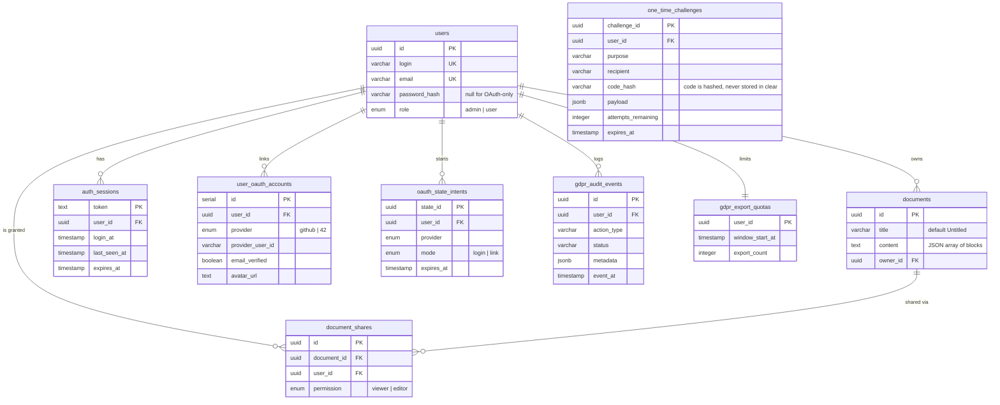

*This project has been created as part of the 42 curriculum by bszikora, mandre, afelger and blohrer.*

# Transcendence Editor

## Description

Ever wanted to write a document together with three other people without emailing versions back and forth? **Transcendence Editor** (PWA name: *TransEdit*) is a collaborative, block-based text editor for the web. Open a document, share it by email, and watch everyone's changes appear live.

A document is not one blob of text but a list of **blocks**  paragraphs, headings, lists, code, citations, links. A block is locked by whoever is editing it and released afterwards, so several people work in the same document without silently overwriting each other.

Access comes from three sources, resolved in one single place in the code: **ownership**, a **share** (`viewer` or `editor`), and the **admin role**, which reaches every document. The REST API and the WebSocket layer call the same resolver, so the rules cannot drift apart.

**Key features:** live block editing with per-block locking · document sharing with graded permissions · two-factor authentication by email · OAuth 2.0 login (GitHub, 42) · role-based admin area · search, sorting and pagination · GDPR export and deletion · installable PWA · single HTTPS entry point.

## Installation instructions

Make sure you have **Docker** (20.10+, with the Compose V2 plugin), **GNU Make** and **OpenSSL** installed. On Linux, importing the local certificate also needs `certutil` from `libnss3-tools`. Nothing else is needed on the host Node.js, PostgreSQL and nginx all run in containers.

1. Clone the project: `git clone https://github.com/chamaselion/ft_transcendence.git`
2. Get into the project directory: `cd ft_transcendence`
3. Copy the environment file: `cp .env.example .env`
4. Generate a JWT secret with `openssl rand -hex 32` and paste it into `JWT_SECRET` in `.env`
5. Change `POSTGRES_PASSWORD` and the matching password inside `DATABASE_URL`
6. Set `ADMIN_EMAIL` in `.env` to the address you will register with
7. Run the project: `make up` (this also generates the local TLS certificates in `certs/`)
8. Trust the local certificate once with `make trust-cert` (Linux: imports into Chrome/Chromium and Firefox; macOS: imports into the System keychain with `sudo`), restart the browser, and go to **https://localhost:8443**
9. Register normally, then read your 2FA code from the backend log:
   `docker compose logs -f backend`
10. To get the admin role, restart the backend once after registering:
    `docker compose restart backend`
    `ADMIN_EMAIL` only promotes an account that already exists — it never creates one,
    and it is the only way to create the *first* admin. Every other user stays a
    regular `user`; further admins are promoted by that admin via the user management UI.
11. Stop the app: `make down` · full reset including the database: `make clear`

> **Always open the app on `https://localhost:8443`

> To remove the locally trusted certificate again, run `make untrust-cert`, then `make clean-certs` to delete the generated certificate files.

**Useful defaults in `.env`:** `HTTPS_HOST_PORT=8443`, `DB_HOST_PORT=5433`, `JWT_EXPIRES_IN=7d`, `ONE_TIME_CODE_TTL_MS=600000`. `EMAIL_TRANSPORT=console` prints every one-time code to the backend log instead of sending mail set it to `smtp` with real SMTP credentials for actual delivery.

**OAuth 2.0 is optional.** Local login works without it. To enable it, register an OAuth app at GitHub and/or the 42 intranet and fill in the `OAUTH_*_CLIENT_ID` / `OAUTH_*_CLIENT_SECRET` pairs. The redirect URIs in `.env.example` already match the default port and must be registered identically at the provider.

Both frontend and backend are hot-reloaded when you save a file. The database is reachable directly on `localhost:5433` for debugging see `docker-compose.yaml` for the credentials.

## Team Formation

| Member | Role | Responsibilities |
|---|---|---|
| **bszikora** (Balint Szikora) | Tech Lead / Architect | Backend architecture and stack decisions. Database and model layer, the complete authentication stack, OAuth 2.0 and GDPR. Reviews critical changes, owns the `.env` contract. |
| **mandre** (Mateo Andre) | PM (Project Manager) | Team coordination, progress and blockers. Frontend application shell, authentication UI, the admin interface, PDF export and the PWA. Set up and maintains CI. |
| **afelger** (Alain Felger) | PO (Product Owner) | Feature backlog and product direction. The block editor and the custom design system. Co-designed the block-locking protocol. |
| **blohrer** (Benjamin Lohrer) | Backend Dev / Documentation | Documents, sharing and the permissions system. The WebSocket real-time layer, advanced search, nginx. API reference and integration test scripts. |

Everyone is a developer in addition to the role listed, and everyone reviews pull requests.

## Project Management

Work was split along a clear seam backend (Balint, Benjamin) and frontend (Alain, Mateo) with the WebSocket protocol as the contract between the two sides. Each feature gets its own branch and exactly one pull request. Interfaces were documented under `docs/API-s/` *as* they were built, so the frontend could work against a written contract instead of reading backend source.

The team meets one to two times per week to sync on progress, agree on the next
tasks and clear blockers. Decisions taken in those meetings are written back into
Discord or the repository so they stay findable. Between meetings the team works
asynchronously: day-to-day alignment runs through Discord and through pull request
reviews, which every change passes.

**Tools**

- **GitHub**: Issues for tasks, Pull Requests with at least one approving review before merge, Actions for CI (type-check and production build of the SPA on every PR)
- **Discord**: main communication channel, with a commits channel mirroring repository activity
- **`docs/` in the repository**: API reference, backend summary, module list and status

## Technical Stack

There are four parts to the application, each with a distinct job:

- **Frontend** — **Vue 3** with TypeScript, Vite, Vue Router and Pinia. Vue was chosen for single-file components, which keep template, logic and scoped styles of one design-system component together valuable when the whole UI library is hand-built and for the shortest learning curve of the three big frameworks for a team that had used none of them. Talks only to nginx.
- **Backend** — **Express** on Node.js 22, with `ws` for WebSockets. A small, unopinionated framework that does not hide how HTTP works, which mattered for the real-time layer: the WebSocket upgrade is intercepted on the raw Node HTTP server *before* Express sees it, so an unauthenticated client is rejected with a `401` before a connection ever exists.
- **Database** — **PostgreSQL 16**, accessed through the **Sequelize** ORM. Chosen for features the data model actually relies on: a real `uuid` type (normalised by the database instead of compared as strings), `ENUM` types that make an invalid role or permission impossible at the storage level, `JSONB` for audit metadata, and `ILIKE` for case-insensitive search. SQLite would not survive the editor's concurrent writes; MySQL offers neither native `uuid` nor comparable `JSONB`.
- **Reverse proxy** — **nginx 1.27**, the single HTTPS entry point. Every request goes through it. This is a security property, not a convenience: one origin means the session cookie can be `httpOnly`, `secure` and `sameSite=strict`, and it solves WebSocket authentication the browser WebSocket API cannot set custom headers, but it does send cookies for the same origin, so the handshake authenticates with exactly the same cookie as every REST call.

**Other notable choices:** `bcryptjs` for password hashing, `sanitize-html` to strip HTML from all user content at both entry points, `jsonwebtoken` plus a server-side session table (deliberately *not* stateless a signed token alone cannot be revoked, so every request verifies the signature *and* checks that the session row still exists), `nodemailer` for one-time codes, `vite-plugin-pwa` for the manifest and service worker, Tabler Icons for the design system.

## Database Schema

All nine tables are generated by Sequelize from `srcs/backend/src/db/models/`. Columns are `snake_case` in the database and `camelCase` in the application. Every foreign key to `users` is `ON DELETE CASCADE`, so deleting an account removes its documents, shares, sessions and linked identities with it.

## Features List

Tasks were split mostly between who did backend and who did frontend.

**Authentication & accounts** *(Balint)* — registration · login with mandatory 2FA by email code · password reset · email- and password changes confirmed by a fresh code · server-side session list · per-route rate limiting

**OAuth 2.0** *(Balint, frontend Mateo)* — GitHub and 42 login · linking a provider to an existing account · setting a password on an OAuth-only account · CSRF protection via a persisted `state` row

**GDPR** *(Balint)* — data request · JSON and CSV export · email-confirmed account deletion · append-only audit log · windowed export quota

**Documents, sharing & permissions** *(Benjamin)* — document CRUD · sharing by email address with `viewer` / `editor` grants · one permission resolver used by both REST and WebSocket · graded actions (viewer reads, editor writes, only the owner deletes or re-shares)· admin-only user CRUD

**Advanced search** *(Benjamin)* — Filter on documents and users, with a `pagination` block carrying the pre-paging total

**Real-time layer** *(Benjamin — transport, auth, permissions · Alain — block protocol)* — authenticated WebSocket handshake · one room per document with efficient broadcast · block create/edit/delete and title updates under a per-document write lock · block locking with timeout and disconnect release · 30-second ping/pong heartbeat · live revocation of sessions and permissions

**Frontend application** *(Mateo)* — SPA shell, router, Pinia stores and theming · login, registration, OTP entry, OAuth and settings views · admin user listing and editing · PDF export · PWA manifest and service worker

**Editor & design system** *(Alain)* — block editor with a component per block type (paragraph, heading, list, code, citation, hyperlink) · editor navigation · document directory with pagination · share modal · 20 reusable components with a shared palette, typography, icon set and light/dark themes, browsable at `/test`

**Technical (features for developers)** — single HTTPS entry point via nginx · four-service Docker Compose stack with a health-checked database · documented `.env` contract · full REST reference under `docs/API-s/` · integration test scripts under `scripts/` · GitHub Actions type-check and build on every PR

## Modules

| Points | Module | Developers | Justification & implementation |
|---|---|---|---|
| 2 | Use a framework for both the frontend and backend | Everyone | Vue 3 + TypeScript on the frontend, Express on the backend. Chosen for a hand-built component library and for keeping control of the raw HTTP upgrade. |
| 2 | Real-time features using WebSockets | Benjamin, Alain | A collaborative editor is the canonical case for server push; polling is either slow or wasteful. `ws` in `noServer` mode so the upgrade can be authenticated and path-filtered first; per-document rooms, one serialisation per broadcast, 30s heartbeat. |
| 2 | Advanced permissions system | Benjamin | Without it the app is a single-user notepad. A `role` enum, an admin-only user CRUD API, a `document_shares` table carrying `viewer`/`editor`, and one resolver called by both REST and WebSocket. Actions gated by rank, not by enumerating levels; admins additionally see the owner of every document. |
| 1 | Use an ORM for the database | Balint | Parameterised queries by default, schema as code, relations as objects. Sequelize, with associations declared centrally to avoid circular imports and `ON DELETE CASCADE` pushed into the foreign keys. |
| 1 | GDPR compliance features | Balint | A product storing personal data in the EU needs export and deletion. JSON/CSV export, confirmed deletion, an append-only audit table and a windowed quota. |
| 1 | Complete 2FA system | Balint | A session cookie alone is a single point of failure for account takeover. One shared one-time-code toolkit serves login, password reset, profile change and deletion; codes are hashed, expire and have limited attempts. Email codes only — no TOTP app. |
| 1 | Remote authentication with OAuth 2.0 | Balint, Mateo | 42 is natural for this cohort, GitHub covers the general case. Server-side authorization-code flow, `state` persisted as a short-lived row for CSRF protection, linked identities unique per provider and per user. |
| 1 | Real-time collaborative features | Alain, Benjamin | The core promise of the product. Documents are a JSON array of blocks; a client locks a block before editing and releases it afterwards, with locks expiring on timeout and on disconnect. |
| 1 | Custom-made design system (min. 10 components) | Alain | A consistent UI built from reusable parts rather than a library bolted on. 20 hand-built Vue components with a shared palette, typography, Tabler icons and light/dark themes, demonstrated in a catalogue route. |
| 1 | Advanced search with filters, sorting and pagination | Benjamin | The list endpoints returned every row at once and became unusable as data grew. A shared parser validates all query parameters for any list endpoint; limits are capped, SQL `LIKE` wildcards in the search term are escaped, and sort fields are whitelisted — a column name cannot be a bound parameter, so the whitelist is what keeps `ORDER BY` from being an injection point. |
| 1 | Progressive Web App | Mateo | An editor people return to daily benefits from being installable, and it is inexpensive on a Vite stack. `vite-plugin-pwa` with a manifest and an auto-updating service worker. |
| 1 | Support for additional browsers | Everyone | The application uses no vendor-specific APIs, so broad support is mostly verification. Standard ES modules, no prefixed CSS; verified on Chrome, edge, safari and Firefox — see Known Limitations. |

**TOTAL: 15 points** (3 Major × 2 + 9 Minor × 1)

## Individual Contributions

### bszikora (Balint Szikora)

- Backend architecture, Sequelize setup, the model layer and the association graph
- Registration, login, the shared one-time-code toolkit, password reset and confirmed profile changes
- Session persistence and the rate-limiting middleware
- OAuth 2.0 for GitHub and 42 end to end, including state-based CSRF protection and account linking
- The complete GDPR subsystem: export in two formats, confirmed deletion, audit log, export quota
- Most of `docs/` and the original pull-request review automation

*Challenge:* designing one code mechanism general enough for login, password reset, profile change and deletion without four near-identical implementations solved with a toolkit parameterised by `purpose` and `payload`. The OAuth round trip needs state across two separate HTTP requests, which is why `oauth_state_intents` is a table and not an in-memory map.

### blohrer (Benjamin Lohrer)

- Documents CRUD, the sharing system and the single permission resolver that makes the permissions module one implementation instead of two
- Roles, the admin-only user API, admin bootstrapping and the `requireRole` middleware
- The WebSocket layer: authenticated upgrade, rooms, broadcast, heartbeat, live session and permission revocation
- Advanced search as a shared, endpoint-agnostic query parser
- nginx as the single HTTPS entry point
- The REST API reference under `docs/API-s/`, the integration test scripts, and this README

*Challenges:* a WebSocket authenticates once and then lives for hours, so a logout left the connection fully working fixed by carrying the session token on the socket and re-checking it on every heartbeat tick, plus direct push from the REST side. Dead connections are invisible: a closed laptop leaves a TCP socket that looks open for minutes, so `close` never fires solved with ping/pong and `terminate()` instead of `close()`, which would wait for a reply from someone no longer there. And PostgreSQL compares `uuid` case-insensitively while JavaScript compares strings byte for byte, so an upper-case ID in a URL deleted the right row but matched no open socket, leaving a revoked user still editing.

### afelger (Alain Felger)

- The block editor: the `Editor` shell, `EditorBlock` and a component per block type
- The editor data layer and the Pinia editor store
- Document directory with pagination, and the share modal
- The design system: 20 components, shared palette, typography, icons, light/dark themes and a catalogue route
- Co-designed the block-locking protocol and implemented its client half plus parts of the server handlers

*Challenge:* the first editor sent the whole document on every keystroke, so two people typing at once silently lost one version. After weighing operational transformation and CRDTs against the remaining time, the team chose block-level locking: it genuinely prevents the loss, is explainable to a user ("someone else is editing this paragraph"), and did not require rewriting both client and server around a merge algorithm.

### mandre (Mateo Andre)

- Scaffolded the Vue 3 + Vite + TypeScript SPA: routing, auth store, application layout
- The complete authentication UI login, registration, one-time-code entry, OAuth buttons, user settings
- The administrator interface for listing and editing users
- PDF export
- PWA integration: manifest, icons, service worker
- The GitHub Actions pipeline that type-checks and builds the SPA on every pull request

*Challenge:* the single-origin requirement. Early frontend work opened the SPA directly on the Vite dev-server port, which is a different origin from the API, so the `sameSite=strict` cookie was never sent and login looked like a backend bug. Resolved by routing all development traffic through nginx and documenting the constraint for the team.

## Resources

- [MDN — WebSockets API](https://developer.mozilla.org/en-US/docs/Web/API/WebSockets_API)

### Use of AI

AI assistants were used as a reviewer, not as a code generator handed finished features. Every suggestion was read, understood and adapted before it entered the repository, and nothing was merged that its author could not explain.

## License & Credits

MIT. Built at [42 Heilbronn](https://www.42heilbronn.de/) as the `ft_transcendence` group project. Icons by [Tabler Icons](https://tabler.io/icons) (MIT).
