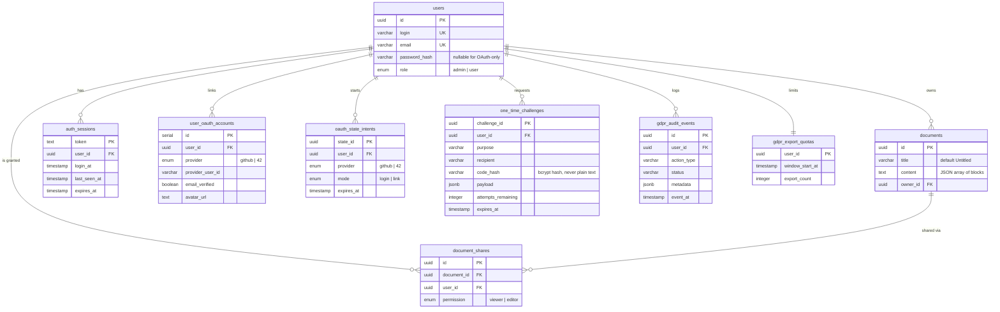

*This project has been created as part of the 42 curriculum by bszikora, mandre, afelger, blohrer.*

# Transcendence Editor

## Description

Ever wanted to write a document together with three other people — even in different languages — without emailing versions back and forth? **Transcendence Editor** (PWA name: *TransEdit*) is a collaborative, block-based text editor for the web. Open a document, share it by email, and watch everyone's changes appear live.

A document is not one blob of text but an ordered list of **blocks** — paragraphs, headings (`H1`–`H6`), ordered and unordered lists, syntax-tagged code blocks, citations, and hyperlinks. A block is locked by whoever is editing it and released afterwards (or automatically upon inactivity or disconnect), so several people can work in the same document simultaneously without silently overwriting each other.

Documents are stored canonically in English while allowing each collaborator to view and edit in **English, German, or Hungarian**. When a user switches language, non-code blocks are translated on the fly via the backend AI layer, and edits made in German or Hungarian are contextually back-translated to canonical English on save while displaying a foldable canonical preview. Paragraph blocks can also be rewritten in real time via **Server-Sent Events (SSE) streaming** using eight specialized AI personas.

Access comes from three sources, resolved in one single place in the code: **ownership**, a **share** (`viewer` or `editor`), and the **admin role**, which reaches every document. Both the REST API and the WebSocket layer call the same resolver, so permission rules can never drift apart.

**Key features:** live multi-user block editing with per-block locking · AI block elaboration with SSE streaming (8 personas) · multilingual UI (`en`, `de`, `hu`) & live cross-language collaborative editing · document sharing with graded permissions · mandatory two-factor authentication by email OTP · OAuth 2.0 login & account linking (GitHub, 42) · S3-backed profile icon upload with `sharp` WebP normalization · role-based admin panel · advanced search, filtering, sorting and pagination · GDPR export (JSON/CSV) and confirmed deletion · WYSIWYG A4 PDF export · installable PWA · single HTTPS entry point.

---

## Instructions

### Prerequisites

Make sure you have **Docker** (20.10+, with the Compose V2 plugin), **GNU Make** and **OpenSSL** installed. On Linux, importing the local certificate into browser trust stores also requires `certutil` from `libnss3-tools`. Nothing else is needed on the host — Node.js, PostgreSQL, RustFS (S3 object storage), and nginx all run inside containers.

### Step-by-Step Setup

1. Clone the project:
   ```bash
   git clone https://github.com/chamaselion/ft_transcendence.git
   cd ft_transcendence
   ```
2. Copy the environment template:
   ```bash
   cp .env.example .env
   ```
3. Generate a JWT secret with `openssl rand -hex 32` and set `JWT_SECRET` in `.env`.
4. Change `POSTGRES_PASSWORD` and the matching password inside `DATABASE_URL` in `.env`.
5. Set `ADMIN_EMAIL` in `.env` to the email address you will register the admin with.
6. *(Optional)* Configure S3 credentials (`S3_ACCESS_KEY`, `S3_SECRET_KEY`, `S3_BUCKET` — working defaults are already provided in `.env.example` for the local RustFS container) and AI provider settings (`AI_PROVIDER=mock` works out of the box without external API keys; set `AI_PROVIDER=openai`, `deepseek`, or `anthropic` alongside `AI_API_KEY` for live LLM inference).
7. Start the development stack:
   ```bash
   make up
   ```
   *(This also generates local self-signed TLS certificates in `certs/` for `localhost` and `s3.localhost`, initializes PostgreSQL, and provisions the S3 bucket via `obj-storage-init`.)*
8. Trust the local certificate once with:
   ```bash
   make trust-cert
   ```
   *(Linux: imports into Chrome/Chromium NSS DB and Firefox profiles; macOS: imports into the System keychain with `sudo`.)* Restart your browser and open **https://localhost:8443**.
9. Register a new account (accepting the Terms of Service & Privacy Policy), then read your 6-digit 2FA login code from the backend log:
   ```bash
   docker compose logs -f backend
   ```
10. To bootstrap the first `admin` account, restart the backend once after registering with `ADMIN_EMAIL`:
    ```bash
    docker compose restart backend
    ```
    `ADMIN_EMAIL` only promotes an account that already exists — it never creates one, and it is the only way to create the *first* admin. Further admins can be promoted by that admin via the Admin View (`/admin`).
11. **Production mode:** Run `make prod` to build and serve the immutable production bundle (`docker-compose.prod.yaml`).
12. **Stopping & cleanup:**
    - Stop containers: `make down` (or `make down-prod`)
    - Full reset including volumes and images: `make clear` (or `make clear_all`)
    - Remove trusted certificate: `make untrust-cert && make clean-certs`

> **Always open the app via the single HTTPS entry point: `https://localhost:8443` (or `https://localhost` in `make prod`).**

**Useful defaults in `.env`:** `HTTPS_HOST_PORT=8443`, `DB_HOST_PORT=5433`, `JWT_EXPIRES_IN=7d`, `ONE_TIME_CODE_TTL_MS=600000`. `EMAIL_TRANSPORT=console` logs every one-time code to `docker compose logs backend`; set `EMAIL_TRANSPORT=smtp` with valid `SMTP_*` credentials for real email delivery.

**OAuth 2.0 is optional.** Local email + password + 2FA login works without it. To enable OAuth 2.0, register an OAuth application on GitHub and/or the 42 intranet and fill in `OAUTH_GITHUB_CLIENT_ID` / `OAUTH_GITHUB_CLIENT_SECRET` and/or `OAUTH_42_CLIENT_ID` / `OAUTH_42_CLIENT_SECRET`. The redirect URIs in `.env.example` already match `https://localhost:8443/api/auth/oauth/<provider>/callback`.

---

## Team Information

| Member | Assigned Role(s) | Responsibilities |
|---|---|---|
| **bszikora** (Balint Szikora) | **Tech Lead / Architect** + Developer | Backend architecture and stack decisions. Database schema and Sequelize model layer, complete authentication stack (2FA/OTP toolkit, sessions, rate limiting), OAuth 2.0 (GitHub & 42), GDPR compliance subsystem, and AI service integration. Reviews critical changes and owns the `.env` contract. |
| **mandre** (Mateo Andre) | **Project Manager (PM) / Scrum Master** + Developer | Team coordination, meeting facilitation, progress tracking, and blocker removal. Frontend SPA shell, authentication UI, OAuth consent/callback flows, user settings, S3 profile icon upload pipeline (`multer`, `sharp`, RustFS), admin interface, WYSIWYG PDF export, and PWA setup. Set up and maintains GitHub Actions CI. |
| **afelger** (Alain Felger) | **Product Owner (PO)** + Developer | Product vision, feature backlog prioritization, and stakeholder communication (`afelger@student.42heilbronn.de`). The block editor, custom 20-component design system, document directory, share modal, i18n localization (`en`, `de`, `hu`), and frontend AI elaboration/translation integration. Co-designed the block-locking protocol. |
| **blohrer** (Benjamin Lohrer) | **Developer / Documentation Lead** | Documents CRUD, sharing, and the unified permissions system. The WebSocket real-time collaboration layer, advanced search/filter/sort/pagination parser, and nginx TLS reverse proxy. Authored the API reference under `docs/API-s/` and integration test scripts under `scripts/`. |

---

## Project Management

Work was split along a clear architectural seam — backend (**bszikora**, **blohrer**) and frontend (**afelger**, **mandre**) — with the REST API documentation (`docs/API-s/`) and WebSocket message protocol serving as written contracts between both sides. Each feature was developed on a dedicated branch and merged via Pull Request after code review and automated CI checks.

The team met once or twice per week to sync on progress, prioritize the backlog, and resolve blockers. Decisions were documented in Discord and under `docs/` so they stayed discoverable. Between meetings, day-to-day coordination ran asynchronously through Discord and GitHub Pull Request reviews.

**Tools & Channels:**
- **GitHub Issues & Pull Requests:** Task tracking, branch-per-feature workflow, and mandatory peer review before merge.
- **GitHub Actions CI (`.github/workflows/frontend-ci.yml`):** Automated `vue-tsc` type-checking and production Vite build on every PR.
- **Discord:** Primary communication channel for daily syncs, architectural discussions, and webhook commit notifications.
- **`docs/` & `scripts/`:** Living API specification (`docs/API-s/`, `docs/BACKEND_SUMMARY.md`, `docs/user-icons.md`) and end-to-end integration test suites (`scripts/test-*.sh`, `scripts/test-*.js`).

---

## Technical Stack

The application is deployed as a **six-service Docker Compose stack**, where each service has a single, well-defined responsibility:

- **Frontend (`frontend`) — Vue 3 + TypeScript + Vite + Tailwind CSS v4 + Pinia + Vue Router + `vue-i18n`:**
  - **Vue 3 SFCs + TypeScript:** Chosen so template, reactive logic, and scoped styles for each design-system and editor block component live together with strict compile-time type safety.
  - **Tailwind CSS v4 (`@tailwindcss/vite`) + Custom CSS Design Tokens (`theme.css`):** Provides utility classes mapped onto semantic CSS custom properties (`--bg-surface`, `--text-primary`, `--color-primary`, etc.) for seamless light/dark theming.
  - **Pinia & Vue Router:** Centralizes authentication (`stores/auth.ts`) and live editor/translation state (`stores/editor.ts`), with route guards protecting `/editor` and `/admin`.
  - **`vue-i18n` & `vue-pdf-export` & `vite-plugin-pwa`:** Powers lazy-loaded localization (`en`, `de`, `hu`), A4 paginated PDF generation, and offline-capable PWA installation.
- **Backend (`backend`) — Express on Node.js 22 + `ws`:**
  - Chosen as an unopinionated HTTP framework that exposes the underlying Node.js `http.Server`. This is critical for `ws` in `noServer` mode: WebSocket upgrade requests (`GET /api/ws`) are intercepted and authenticated on the raw HTTP server *before* Express middleware runs, rejecting unauthenticated upgrades with `401 Unauthorized` immediately.
  - Includes **`multer`** and **`sharp`** for validating, stripping EXIF metadata, cropping, and transcoding uploaded user avatars to `256×256` WebP images, **`@aws-sdk/client-s3`** for object storage operations, and a provider-agnostic **AI service layer** supporting OpenAI, DeepSeek, Anthropic, and a deterministic Mock provider.
- **Database (`db`) — PostgreSQL 16 + Sequelize ORM:**
  - Chosen over SQLite and MySQL for native `uuid` primary keys, strict `ENUM` types (`admin | user`, `viewer | editor`, `github | 42`), `JSONB` columns for OTP challenge payloads and GDPR audit metadata, `ILIKE` for case-insensitive search, and transactional row locking (`transaction.LOCK.UPDATE`).
- **Object Storage (`obj-storage` & `obj-storage-init`) — RustFS 1.0.2 (S3-Compatible Storage):**
  - Stores normalized user profile icons (`user-icons/<user-id>.webp`) outside the relational database, keeping PostgreSQL lean while `obj-storage-init` (`rustfs/rc`) automatically provisions the bucket on startup.
- **Reverse Proxy (`nginx`) — nginx 1.27:**
  - Acts as the **single HTTPS entry point** (TLSv1.2/1.3, redirecting port 80 to 443) and proxies `/api/`, `/health`, `/api/ws` (WebSocket upgrade), and `/` (SPA), plus `s3.localhost` for object storage. Serving the SPA, REST API, and WebSocket endpoint from a single origin allows session cookies to be `httpOnly`, `Secure`, and `SameSite=Strict`, and enables browser WebSocket handshakes to authenticate automatically using that same cookie.

**Other notable libraries:** `bcryptjs` (salted password and OTP code hashing), `jsonwebtoken` paired with a database-backed `auth_sessions` table (enabling instant server-side session revocation on logout, password reset, or admin deletion), `sanitize-html` (defense-in-depth HTML stripping on all document and block inputs), `nodemailer` (email OTP & GDPR notifications), and `@tabler/icons-vue`.

---

## Database Schema



All nine relational tables are defined via Sequelize models in `srcs/backend/src/db/models/` with centralized associations in `srcs/backend/src/db/associations.js`. Database columns use `snake_case` while application properties use `camelCase`. Foreign keys referencing `users` use `ON DELETE CASCADE`, and user profile icons are stored as objects at `<S3_BUCKET>/<user-id>.webp` in RustFS S3 storage.

---

## Features List

- **Authentication & Account Security** *(bszikora, mandre)* — Email/username/password registration with Terms of Service & Privacy Policy consent · mandatory 2FA email OTP on login · OTP-confirmed password reset · OTP-confirmed email and username updates · server-side session persistence (`auth_sessions`) · per-route rate limiting (`rateLimit.js`).
- **OAuth 2.0 Remote Authentication** *(bszikora, mandre)* — Authorization-code flow for **GitHub** and **42** · explicit Terms consent screen · linking OAuth providers to existing accounts · setting a local password on OAuth-only accounts · persistent database CSRF `state` verification (`oauth_state_intents`).
- **Profile Icons & S3 Object Storage** *(mandre, bszikora)* — Multipart avatar upload (`PUT /api/auth/me/icon`), retrieval (`GET /api/auth/me/icon`), and removal (`DELETE /api/auth/me/icon`) · server-side validation and normalization with `sharp` (rejects animated/oversized images >16M pixels or >2 MiB, strips metadata, crops to `256×256` WebP) · stored in RustFS S3 bucket with row-level DB locking.
- **GDPR Compliance & Privacy** *(bszikora, mandre, afelger)* — Personal data request (`POST /api/auth/me/data-request`) · full data export in **JSON** and **CSV** formats · OTP-confirmed account deletion purging both PostgreSQL records and S3 avatar objects · append-only audit log (`gdpr_audit_events`) and windowed export quotas (`gdpr_export_quotas`) · accessible **Terms of Service**, **Privacy Policy**, and **EU Cookie & Storage Notice** modals.
- **Documents, Sharing & Advanced Permissions** *(blohrer, afelger, mandre)* — Document CRUD · collaborator sharing by email with `viewer` or `editor` permissions · unified permission resolver (`permissions.js`) shared by REST and WebSocket · role-based Admin panel (`/admin`) with user listing, inspection, username editing, admin promotion/revocation, and confirmed user deletion.
- **Real-Time WebSocket Collaboration & Block Locking** *(blohrer, afelger)* — Authenticated WebSocket upgrade (`/api/ws`) · per-document rooms with single-serialization broadcast · per-document write queue (`withDocumentWriteLock`) preventing race conditions · live block create/edit/delete and title updates · per-block locking with 5-second inactivity timeout and automatic disconnect release · 30-second ping/pong heartbeat · instant live revocation of sessions and document permissions.
- **AI Block Elaboration & Cross-Language Translation** *(bszikora, afelger)* — Streaming paragraph elaboration (`POST /api/ai/elaborate/stream`) over **Server-Sent Events (SSE)** with 8 personas across 3 categories (*Structural & Analytical*, *Tone & Voice*, *Action & Delivery*) · batch and single-block contextual translation (`POST /api/ai/translate`) between English, German, and Hungarian · canonical English storage with foldable original-text preview (`FoldableTextPreview.vue`) and automatic back-translation on blur · pluggable provider adapters (`OpenAI`, `DeepSeek`, `Anthropic`, `Mock`) with rate limiting and `AbortController` timeouts.
- **Internationalization (i18n)** *(afelger, mandre)* — Full UI localization in **English (`en`)**, **German (`de`)**, and **Hungarian (`hu`)** via `vue-i18n` · lazy-loaded locale bundles · persistent `LanguageSwitcher.vue` in the application header · synchronized with the editor's live document translation.
- **Advanced Search, Filtering, Sorting & Pagination** *(blohrer, afelger, mandre)* — Shared backend query parser (`listQuery.js`) with SQL `ILIKE` wildcard escaping, whitelisted sort columns, and pre-paging `total` counts · Document Directory (`DocumentToolbar.vue`, `DocumentPagination.vue`) with live debounced search (`q`), ownership scope filters (`all`, `own`, `shared`), sort field selector (`updatedAt`, `createdAt`, `title`), sort order toggle (`ASC`/`DESC`), and page size/navigation · Admin User List (`UserManagingList.vue`) with search, role filter (`admin`, `user`), sort field/order, and pagination.
- **Block Editor, Custom Design System & PDF Export** *(afelger, mandre)* — Block editor supporting Paragraph (with alignment), Heading (`H1`–`H6`), List (ordered/unordered), Code (15 languages), Citation, and Hyperlink · 20 custom Vue components with light/dark theme support and interactive showcase at `/test` (`ComponentCatalouge.vue`) · WYSIWYG A4 PDF export (`vue-pdf-export`) · installable PWA with service worker (`vite-plugin-pwa`).

---

## Modules

The project implements **4 Major modules (8 points)** and **10 Minor modules (10 points)** from the official subject categories, plus **1 Minor Module of Choice (1 point)**, totaling **19 points** (14 mandatory points + the maximum 5 bonus points).

| Points | Type | Module (Category) | Developers | Justification & Implementation |
| :---: | :---: | :--- | :--- | :--- |
| **2** | Major | **Use a framework for both the frontend and backend** *(IV.1 Web)* | Everyone | **Vue 3** (with TypeScript, Vite, Vue Router, Pinia) on the frontend and **Express** on the backend. Vue SFCs keep template, logic, and styles together for our 20-component design system; Express gives full control over the raw Node HTTP server for authenticated WebSocket upgrades. |
| **2** | Major | **Implement real-time features using WebSockets** *(IV.1 Web)* | Benjamin, Alain | Real-time collaboration requires low-latency server push. Implemented via `ws` in `noServer` mode (`documentSocket.js`) with cookie-authenticated HTTP upgrades, per-document rooms, single-serialization broadcasts, 30s ping/pong heartbeats, and instant push eviction when a session or share is revoked. |
| **2** | Major | **Advanced permissions system** *(IV.3 User Management)* | Benjamin, Mateo | Combines global RBAC (`admin` vs. `user` enum enforced by `requireRole('admin')` and the `/admin` user management CRUD UI) with resource-level ACLs (`owner`, `editor`, `viewer` via `document_shares`). A single permission resolver (`permissions.js`) is called by both REST controllers and WebSocket handlers. |
| **2** | Major | **Implement a complete LLM system interface** *(IV.4 Artificial Intelligence)* | Balint, Alain | Writers need in-context AI assistance without leaving the editor. Implements `POST /api/ai/elaborate/stream` (Server-Sent Events streaming with 8 specialized personas), `GET /api/ai/personas`, and `POST /api/ai/translate` (contextual batch & single-block translation). Includes pluggable adapters for **OpenAI**, **DeepSeek**, **Anthropic**, and **Mock** (`providers/index.js`), per-user rate limiting (60 req/min in `routes/ai.js`), 15s idle timeouts, `AbortController` cancellation, and automatic block rollback on error. |
| **1** | Minor | **Use an ORM for the database** *(IV.1 Web)* | Balint | **Sequelize** ORM (`srcs/backend/src/db/`) defines all 9 PostgreSQL tables, centralizes foreign-key associations with `ON DELETE CASCADE`, prevents SQL injection via parameterized queries, and manages transactions (`LOCK.UPDATE`). |
| **1** | Minor | **Real-time collaborative features** *(IV.1 Web)* | Alain, Benjamin | Documents are structured as a JSON array of blocks. Collaborators lock a block on focus (`block_lock`), stream edits (`block_edit`, `block_create`, `block_delete`, `title_update`) serialized through a per-document write lock (`withDocumentWriteLock`), and release locks on blur, 5s inactivity timeout, or disconnect. |
| **1** | Minor | **Custom-made design system (min. 10 components)** *(IV.1 Web)* | Alain | Built 20 reusable Vue components (`Button`, `Card`, `Input`, `Modal`, `Toast`, `Tooltip`, `Icon`, `UserIcon`, `FoldableTextPreview`, `CookieBanner`, `TermsOfServiceModal`, `ShareModal`, `Editor`, `EditorNav`, `EditorBlock`, `EditorParagraph`, `EditorHeading`, `EditorList`, `EditorCode`, `EditorCitation`, `EditorHyperlink`, etc.) backed by semantic light/dark CSS tokens (`theme.css`, `tailwind.css`), typography, and Tabler icons, demonstrated interactively at `/test`. |
| **1** | Minor | **Implement advanced search functionality with filters, sorting, and pagination** *(IV.1 Web)* | Benjamin, Alain, Mateo | Shared query parser (`listQuery.js`) validates `q`, `sort`, `order`, `limit`, and `offset`, escapes SQL `ILIKE` wildcards, and whitelists `ORDER BY` columns. Integrated in both the Document Directory (search by title/content, filter by `all`/`own`/`shared`, sort by `updatedAt`/`createdAt`/`title` in `ASC`/`DESC`, pagination) and the Admin User List (search by login/email, filter by role, sort, pagination). |
| **1** | Minor | **Progressive Web App (PWA) with offline support and installability** *(IV.1 Web)* | Mateo | Configured via `vite-plugin-pwa` (`vite.config.ts`) with a complete Web App Manifest (`TransEdit`, standalone display, 192×192 and 512×512 icons) and an auto-updating Workbox service worker that precaches the application shell for offline loading and desktop/mobile installation. |
| **1** | Minor | **Support for multiple languages (at least 3 languages)** *(IV.2 Accessibility & i18n)* | Alain, Mateo | Implemented with `vue-i18n` (`src/i18n/index.ts`), lazy-loaded locale bundles, `localStorage` persistence, and `LanguageSwitcher.vue` in the header. Provides complete, 469-key translations across **3 languages: English (`en`), German (`de`), and Hungarian (`hu`)** covering every view, modal, error message, and aria-label. |
| **1** | Minor | **Support for additional browsers** *(IV.2 Accessibility & i18n)* | Everyone | Built exclusively on standard Web APIs, ES2022 modules, and standard CSS custom properties. Verified and tested across **Google Chrome**, **Mozilla Firefox**, **Microsoft Edge**, and **Apple Safari**, with automated multi-browser trust-cert tooling in `Makefile` and documented browser notes below. |
| **1** | Minor | **Implement remote authentication with OAuth 2.0** *(IV.3 User Management)* | Balint, Mateo | Full server-side OAuth 2.0 authorization-code flow for **GitHub** and **42** (`oauth2.js`, `OAuth.vue`, `OAuthConsentView.vue`, `OAuthCallbackView.vue`), CSRF protection via database-persisted `oauth_state_intents`, account linking from settings, and password setup for OAuth-only accounts. |
| **1** | Minor | **Implement a complete 2FA system** *(IV.3 User Management)* | Balint, Mateo | Mandatory email One-Time Password (OTP) verification on login, plus OTP challenges for password reset, profile updates, and account deletion (`oneTimeCodeToolkit.js`, `OtpValidation.vue`). Codes are bcrypt-hashed in `one_time_challenges`, expire after 10 minutes, Enforce attempt limits (max 3), and are protected by dedicated rate limiters. |
| **1** | Minor | **GDPR compliance features** *(IV.8 Data and Analytics)* | Balint, Mateo | Implements Art. 15 & 20 data requests and exports in **JSON** (`/api/auth/me/data-export`) and **CSV** (`/api/auth/me/data-export/csv`), Art. 17 OTP-confirmed account deletion (`/api/auth/me/data-deletion/confirm`) with cascade DB & S3 avatar purge, confirmation emails (`gdprNotificationService.js`), append-only audit logs (`gdpr_audit_events`), and windowed export quotas. |
| **1** | Minor | **Module of Choice: Canonical Cross-Language Collaborative Editing & S3 Media Pipeline** *(IV.10 Modules of choice)* | Alain, Balint, Mateo | **Why chosen & value added:** Standard i18n only translates static UI labels, leaving shared document content in a single language. We engineered a **canonical English synchronization layer** (`stores/editor.ts`, `Editor.vue`, `FoldableTextPreview.vue`) where collaborators in English, German, and Hungarian can edit the same document simultaneously in their own native language: incoming WebSocket updates are translated into each viewer's active locale, and local edits in `de`/`hu` are contextually back-translated to canonical English on save while showing a foldable canonical preview. Combined with our S3-compatible **RustFS + `sharp` image processing pipeline** (`userIcon.js`) and **WYSIWYG A4 PDF export**, this addresses complex state-synchronization and media-processing challenges beyond standard modules. |

**TOTAL: 19 points** (4 Major × 2 pts + 11 Minor × 1 pt — 14 mandatory points + 5/5 maximum bonus points)

---

## Individual Contributions

### bszikora (Balint Szikora)
- **Modules & Features:** Backend architecture, PostgreSQL + Sequelize ORM setup, all 9 database models and associations · Registration, login, and the parameterized 2FA/OTP toolkit (`oneTimeCodeToolkit.js`) · Server-side session persistence (`auth_sessions`) and per-route rate limiting (`rateLimit.js`) · Complete OAuth 2.0 backend for GitHub and 42 (`oauth2.js`, `oauth2-state.js`, `oauth2-user-resolution.js`) · Complete GDPR backend subsystem (JSON/CSV export, confirmed deletion, audit logging, export quotas, notification emails) · Backend AI service architecture (`elaborationService.js`, `translationService.js`, `providers/index.js`, `routes/ai.js`) and S3 client integration (`userIconService.js`).
- **Challenges & Solutions:** Designing a single one-time-code mechanism general enough for login 2FA, password reset, profile changes, and GDPR account deletion without duplicating logic — solved by parameterizing `one_time_challenges` by `purpose` and a `JSONB` `payload`. For OAuth 2.0, preserving CSRF state and linking intent across redirects was solved by persisting short-lived rows in `oauth_state_intents` rather than relying on fragile in-memory state.

### blohrer (Benjamin Lohrer)
- **Modules & Features:** Documents CRUD and collaborator sharing API (`controllers/documents/`, `controllers/shares/`) · The unified permission resolver (`permissions.js`) shared across REST and WebSocket · Role-based access control (`requireRole.js`, `adminBootstrap.js`, `usersController.js`) · Complete WebSocket server (`documentSocket.js`): authenticated HTTP upgrade, rooms, broadcast, 30s heartbeat, per-document write lock, and live session/permission revocation · Shared advanced search, filter, sort, and pagination parser (`listQuery.js`) · Single-entry-point nginx TLS configuration (`nginx.conf`) · REST API documentation (`docs/API-s/`) and integration test scripts (`scripts/`).
- **Challenges & Solutions:** A WebSocket authenticates once at handshake time and can stay open for hours, meaning a logged-out user or a collaborator whose share was downgraded could keep editing — solved by attaching the session token to each socket, re-verifying session liveness and document permissions on every 30s heartbeat tick, and pushing immediate eviction events (`evictSession`, `evictFromDocument`, `syncLivePermission`) from REST controllers. Also resolved a subtle bug where PostgreSQL compared `uuid` values case-insensitively while JavaScript `Map`/`Set` lookups were case-sensitive by normalizing UUID strings to lowercase before room membership checks.

### afelger (Alain Felger)
- **Modules & Features:** The block editor architecture (`Editor.vue`, `EditorView.vue`, `EditorNav.vue`, `EditorBlock.vue`, `useEditable.ts`) and all block components (`EditorParagraph`, `EditorHeading`, `EditorList`, `EditorCode`, `EditorCitation`, `EditorHyperlink`) · Pinia editor & canonical translation store (`stores/editor.ts`) · Custom 20-component design system (`Button`, `Card`, `Input`, `Modal`, `Toast`, `Tooltip`, `Icon`, `FoldableTextPreview`, etc.), light/dark theming (`theme.css`, `tailwind.css`), and `/test` component catalogue (`ComponentCatalouge.vue`) · Document Directory (`DocumentDirectory.vue`, `DocumentToolbar.vue`, `DocumentTable.vue`, `DocumentPagination.vue`) and `ShareModal.vue` · Complete i18n system (`src/i18n/`, `en.json`, `de.json`, `hu.json`, `LanguageSwitcher.vue`) · Frontend SSE streaming AI elaboration (`elaboration.api.ts`, `EditorElaborateDropdown.vue`) and cross-language block translation (`translation.api.ts`) · Co-designed the block-locking protocol.
- **Challenges & Solutions:** Early versions of the editor sent the full document on every keystroke, causing concurrent typists to overwrite each other. After evaluating CRDTs and Operational Transformation against project scope, co-designed block-level locking with 2s debounced edits, 5s inactivity auto-unlock, and server write serialization. A second major challenge was keeping block locks alive while streaming AI elaborations and preventing race conditions when users switch UI languages mid-edit — solved with a 3s elaboration lock heartbeat (`startElaborationLockHeartbeat`), monotonic translation request IDs, and canonical English state tracking.

### mandre (Mateo Andre)
- **Modules & Features:** Scaffolded the Vue 3 + Vite + TypeScript SPA, router guards (`router/index.ts`), and auth store (`stores/auth.ts`) · Complete authentication UI (`Login.vue`, `Register.vue`, `OtpValidation.vue`, `PasswordResetModal.vue`, `OAuth.vue`, `OAuthConsentView.vue`, `OAuthCallbackView.vue`) · User Settings view (`UserSettings.vue`) including GDPR JSON/CSV download, OTP profile updates, and account deletion · End-to-end S3 profile icon upload & `sharp` image normalization (`userIcon.js`, `iconUpload.js`, `UserIcon.vue`, `docker-compose.yaml` RustFS setup) · Admin panel UI (`AdminView.vue`, `UserManagingList.vue`, `UserManagmentModal.vue`) · WYSIWYG A4 PDF export integration (`Editor.vue`) · PWA manifest and service worker (`vite.config.ts`) · GitHub Actions CI workflow (`.github/workflows/frontend-ci.yml`).
- **Challenges & Solutions:** Early frontend development accessed the Vite dev server directly on port `8081`, which constituted a cross-origin request to the backend and prevented `SameSite=Strict` `httpOnly` session cookies from being sent. Resolved by routing both development (including Vite HMR WebSockets) and production traffic through the single nginx HTTPS reverse proxy. For PDF export, dark-mode styles and interactive controls bled into generated PDFs — solved by injecting a dedicated print stylesheet and staging clone configuration in `vue-pdf-export`.

---

## Browser Compatibility & Known Limitations

The application is verified across **Google Chrome (latest)**, **Mozilla Firefox (latest)**, **Microsoft Edge (latest)**, and **Apple Safari (macOS)**:

- **Self-Signed TLS Certificates in Development:** Because the stack enforces HTTPS everywhere (`SameSite=Strict; Secure` cookies), browsers will block WebSocket connections (`wss://`) if the local certificate in `certs/nginx.crt` is untrusted. Running `make trust-cert` automatically registers the certificate in NSS (`~/.pki/nssdb` for Chrome/Edge/Chromium), Firefox profile databases, or the macOS System Keychain (for Safari/Chrome on macOS).
- **Safari Private Browsing & `localStorage`:** In strict privacy modes where `localStorage` throws `QuotaExceededError` or `SecurityError`, `src/i18n/index.ts`, `useTheme.ts`, and `CookieBanner.vue` catch storage exceptions gracefully and fall back to in-memory session state and `navigator.language`.
- **Single Backend Instance Write Lock:** The per-document WebSocket write queue (`withDocumentWriteLock` in `documentSocket.js`) is an in-process promise queue designed for a single backend container. Scaling horizontally to multiple backend replicas would require replacing the in-memory room map with Redis pub/sub and PostgreSQL `SELECT ... FOR UPDATE` row locks.
- **Canonical Document Language:** Document titles remain in their original language and code/citation blocks are intentionally excluded from automatic AI translation so source code and direct quotes are never altered by machine translation.

---

## Resources

- [MDN — WebSockets API](https://developer.mozilla.org/en-US/docs/Web/API/WebSockets_API)
- [MDN — Using Server-Sent Events (SSE)](https://developer.mozilla.org/en-US/docs/Web/API/Server-sent_events/Using_server-sent_events)
- [Vue 3 Documentation](https://vuejs.org/guide/introduction.html) & [Pinia Documentation](https://pinia.vuejs.org/)
- [Vue I18n Guide](https://vue-i18n.intlify.dev/)
- [Tailwind CSS v4 Documentation](https://tailwindcss.com/docs)
- [Sequelize v6 Documentation](https://sequelize.org/docs/v6/)
- [RFC 6749 — The OAuth 2.0 Authorization Framework](https://datatracker.ietf.org/doc/html/rfc6749)
- [OWASP — Authentication & Session Management Cheat Sheet](https://cheatsheetseries.owasp.org/)
- [Sharp High-Performance Node.js Image Processing](https://sharp.pixelplumbing.com/)
- [Vite PWA Plugin Documentation](https://vite-pwa-org.netlify.app/)

### Use of AI

In accordance with Chapter I of the subject, AI tools were used responsibly during development for the following specific tasks and parts of the project:
- **Translations (`srcs/frontend/transcendence-spa/src/i18n/locales/de.json`, `hu.json`):** Assisting with initial German and Hungarian translations of UI strings, which were then reviewed and refined by native/fluent speakers on the team.
- **Prompt Engineering (`srcs/backend/src/services/ai/elaborationService.js`, `translationService.js`):** Drafting and refining the system prompts for the 8 AI elaboration personas (*Devil's Advocate*, *TL;DR*, *Storyteller*, *Pragmatist*, *Diplomat*, *Marketer*, *Auditor*, *Specifier*) and structured JSON translation schemas.
- **Code Review, Debugging & Boilerplate:** Reviewing pull requests for edge cases (such as SSE stream chunk boundary parsing, PostgreSQL UUID casing mismatches, and GDPR CSV escaping), and generating integration test scaffolding under `scripts/`.

Every AI suggestion was critically evaluated, tested, and adapted before entering the repository, and every team member can explain and defend all code in the project.

---

## License & Credits

MIT License. Built at [42 Heilbronn](https://www.42heilbronn.de/) (`Weipertstraße 8-10, 74076 Heilbronn`, contact: `afelger@student.42heilbronn.de`) as the `ft_transcendence` group project. Icons by [Tabler Icons](https://tabler.io/icons) (MIT).
