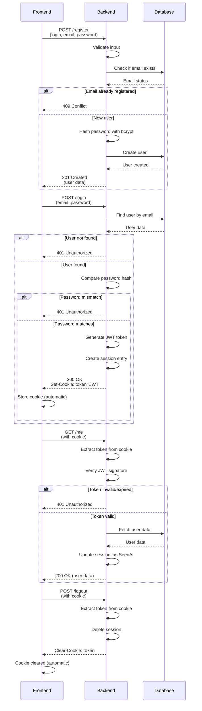

# Authentication API Documentation

## Overview

The backend provides a secure authentication system using JWT (JSON Web Tokens) with httpOnly cookies. All endpoints are accessible at `/api/auth/`.

**Base URL (through WAF):** `https://localhost:9443/api/auth`

---

## Security Features

### 🔒 Security Highlights

1. **httpOnly Cookies**: Authentication tokens are stored in httpOnly cookies, protecting against XSS attacks. Clients cannot access tokens via JavaScript.
2. **Secure Flag**: Cookies are marked `Secure` and are transmitted only over HTTPS.
3. **SameSite=Strict**: Provides CSRF protection by restricting cookie transmission to same-site requests only.
4. **JWT Expiration**: Tokens expire automatically based on `JWT_EXPIRES_IN` environment variable.
5. **Bcrypt Hashing**: Passwords are hashed with bcrypt using `BCRYPT_SALT_ROUNDS` rounds.
6. **CORS Configuration**: Credentials are allowed with proper CORS headers.
7. **Session Tracking**: Active sessions are tracked server-side for enhanced security.

Implementation note: auth handlers are split by endpoint in `srcs/backend/src/controllers/auth/` (`register.js`, `passwordResetRequest.js`, `passwordResetConfirm.js`, `login.js`, `me.js`, `logout.js`, `listSessions.js`) and share session/cookie logic via `helpers.js`. The reusable email code toolkit lives in `oneTimeCodeToolkit.js` and wraps the one-time-code service.

You can refer to the readme for useful resources in JWT and best security practices with it.

---

## Authentication Flow



---

## API Endpoints

### 1. Register a New User

**Endpoint:** `POST /register`

**Description:** Create a new user account.

**Request Headers:**
```
Content-Type: application/json
```

**Request Body:**
```json
{
  "login": "string (username)",
  "email": "string (valid email)",
  "password": "string"
}
```

**Success Response (201 Created):**
```json
{
  "id": "f7b7d0fe-8d8f-41d4-b190-29ce83366e45",
  "login": "john_doe",
  "email": "john@example.com",
  "registered": true
}
```

**Error Responses:**

| Status | Response | Reason |
|--------|----------|--------|
| 400 | `{ "error": "Missing fields" }` | Missing login, email, or password |
| 409 | `{ "error": "Email already in use" }` | Email already registered |
| 500 | `{ "error": "Server error" }` | Unexpected server error |

---

### 2. Login

**Endpoint:** `POST /login`

**Description:** Authenticate with email and password. Returns JWT token via httpOnly cookie.

**Request Headers:**
```
Content-Type: application/json
```

**Request Body:**
```json
{
  "email": "string",
  "password": "string"
}
```

**Success Response (200 OK):**
```json
{
  "id": "f7b7d0fe-8d8f-41d4-b190-29ce83366e45",
  "login": "john_doe",
  "email": "john@example.com",
  "loggedIn": true
}
```

**Response Headers:**
```
Set-Cookie: token=eyJhbGciOiJIUzI1NiIsInR5cCI6IkpXVCJ9...; Path=/; HttpOnly; Secure; SameSite=Strict; Max-Age=604800000
```

**Error Responses:**

| Status | Response | Reason |
|--------|----------|--------|
| 400 | `{ "error": "Missing fields" }` | Missing email or password |
| 401 | `{ "error": "Invalid credentials" }` | Email not found or password incorrect |
| 500 | `{ "error": "Server error" }` | Unexpected server error |

---

### 3. Get Current User (Me)

**Endpoint:** `GET /me`

**Description:** Retrieve the authenticated user's information. Validates JWT token from cookie.

**Request Headers:**
```
Cookie: token=JWT_TOKEN_HERE
```

**Success Response (200 OK):**
```json
{
  "loggedIn": true,
  "user": {
    "id": "f7b7d0fe-8d8f-41d4-b190-29ce83366e45",
    "login": "john_doe",
    "email": "john@example.com"
  }
}
```

**Error Response (401 Unauthorized):**
```json
{
  "loggedIn": false
}
```

**Possible Error Scenarios:**
- No token in cookie
- Token expired
- Token signature invalid
- User not found in database

---

### 4. Logout

**Endpoint:** `POST /logout`

**Description:** Clear user session and remove authentication cookie.

**Request Headers:**
```
Cookie: token=JWT_TOKEN_HERE
```

**Success Response (200 OK):**
```json
{
  "loggedIn": false,
  "loggedOut": true
}
```

**Response Headers:**
```
Set-Cookie: token=; Path=/; HttpOnly; Secure; SameSite=Strict; Max-Age=0
```

**Note:** Works regardless of whether a token exists. Always clears the cookie.

---

### 5. List Active Sessions

**Endpoint:** `GET /sessions`

**Description:** Retrieve all active sessions. Requires authentication. Expired sessions are automatically purged.

**Request Headers:**
```
Cookie: token=JWT_TOKEN_HERE
```

**Success Response (200 OK):**
```json
{
  "count": 2,
  "sessions": [
    {
      "sessionId": "f7b7d0fe-8d8f-41d4-b190-29ce83366e45-1718540123456",
      "userId": "f7b7d0fe-8d8f-41d4-b190-29ce83366e45",
      "login": "john_doe",
      "email": "john@example.com",
      "loginAt": "2026-06-16T10:15:23.456Z",
      "lastSeenAt": "2026-06-16T10:20:45.789Z"
    },
    {
      "sessionId": "f7b7d0fe-8d8f-41d4-b190-29ce83366e45-1718540125789",
      "userId": "f7b7d0fe-8d8f-41d4-b190-29ce83366e45",
      "login": "john_doe",
      "email": "john@example.com",
      "loginAt": "2026-06-16T10:16:45.123Z",
      "lastSeenAt": "2026-06-16T10:21:30.456Z"
    }
  ]
}
```

**Error Response (401 Unauthorized):**
```json
{
  "error": "Unauthorized"
}
```

**Possible Error Scenarios:**
- No token in cookie
- Token expired
- Token invalid

---

### 6. Request Password Reset

**Endpoint:** `POST /password-reset/request`

**Description:** Send a one-time code to the user's email address to begin a password reset.

**Request Headers:**
```
Content-Type: application/json
```

**Request Body:**
```json
{
  "email": "string (valid email)"
}
```

**Success Response (202 Accepted):**
```json
{
  "confirmationId": "c8ef6a31-9c34-4a8d-9d16-2d7b7b8f1a12",
  "email": "john@example.com",
  "attemptsRemaining": 3,
  "codeLength": 6,
  "expiresAt": "2026-06-17T10:30:00.000Z",
  "codeSent": true,
  "message": "If an account exists for that email, a password reset code has been sent."
}
```

**Notes:**
- The response is intentionally generic if the email does not exist.
- A code is delivered through the configured email transport.

---

### 7. Confirm Password Reset

**Endpoint:** `POST /password-reset/confirm`

**Description:** Verify the one-time code and update the account password.

**Request Headers:**
```
Content-Type: application/json
```

**Request Body:**
```json
{
  "confirmationId": "c8ef6a31-9c34-4a8d-9d16-2d7b7b8f1a12",
  "email": "john@example.com",
  "code": "123456",
  "newPassword": "new-password"
}
```

**Success Response (200 OK):**
```json
{
  "passwordReset": true
}
```

**Error Responses:**

| Status | Response | Reason |
|--------|----------|--------|
| 400 | `{ "error": "Missing fields" }` | Required reset fields are missing |
| 401 | `{ "error": "Invalid code..." }` | Code mismatch or attempts exhausted |
| 404 | `{ "error": "User not found" }` | User record no longer exists |
| 410 | `{ "error": "Confirmation code expired or was not found" }` | Expired or missing code |
| 500 | `{ "error": "Server error" }` | Unexpected server error |

---

## Frontend Implementation Guide

### Cookie Management

The authentication system uses **httpOnly cookies**, which means:

✅ **What works:**
- Cookies are automatically sent with every request to the backend
- Cookies are automatically managed by the browser
- No manual token handling needed
- Protected against XSS attacks

❌ **What doesn't work:**
- Cannot access token via JavaScript: `document.cookie` won't show token
- Cannot manually set/clear the token cookie from JavaScript
- No need to store token in localStorage or sessionStorage

### Fetch Configuration

All authenticated requests must include credentials to send cookies:

```javascript
// ✅ CORRECT: Include credentials
fetch('https://localhost:9443/api/auth/me', {
  method: 'GET',
  credentials: 'include', // This is crucial!
  headers: {
    'Content-Type': 'application/json'
  }
});

// ❌ WRONG: Without credentials
fetch('https://localhost:9443/api/auth/me', {
  method: 'GET'
  // Missing credentials: 'include'
});
```

---

## Error Handling Best Practices

### Network Errors
```javascript
async function safeAuthCall(authFunction) {
  try {
    return await authFunction();
  } catch (error) {
    if (error instanceof TypeError) {
      // Network error
      console.error('Network error - cannot reach server');
      showUserMessage('Network error. Please check your connection.');
    } else {
      console.error('Unexpected error:', error);
      showUserMessage('An unexpected error occurred.');
    }
  }
}

// Usage
await safeAuthCall(() => auth.login(email, password));
```

### Session Expiration Handling
```javascript
async function makeAuthenticatedRequest(url, options = {}) {
  let response = await fetch(url, {
    ...options,
    credentials: 'include'
  });

  if (response.status === 401) {
    // Token expired or invalid
    auth.currentUser = null;
    console.warn('Session expired. Redirecting to login...');
    redirectToLogin();
    return null;
  }

  return response;
}
```

### Retry Logic for Failed Requests
```javascript
async function retryRequest(fn, maxRetries = 3) {
  for (let attempt = 1; attempt <= maxRetries; attempt++) {
    try {
      return await fn();
    } catch (error) {
      if (attempt === maxRetries) throw error;
      console.log(`Attempt ${attempt} failed, retrying...`);
      await new Promise(resolve => setTimeout(resolve, 1000 * attempt));
    }
  }
}

// Usage
await retryRequest(() => auth.getCurrentUser());
```

---

## Cookie Management

### How Cookies Work

1. **After Login**: Server sends `Set-Cookie` header with JWT token
2. **Browser Stores**: Cookie is stored automatically (httpOnly prevents JavaScript access)
3. **Auto-Sending**: Cookie is automatically sent with every same-origin request
4. **After Logout**: Server sends `Set-Cookie` with `Max-Age=0` to delete cookie

### Cookie Properties

| Property | Value | Purpose |
|----------|-------|---------|
| `HttpOnly` | true | Prevents JavaScript access (XSS protection) |
| `Secure` | true | Only sent over HTTPS |
| `SameSite` | Strict | Prevents CSRF attacks |
| `Max-Age` | 604800000ms (7 days) | Expiration time |
| `Path` | / | Available on all paths |

### Frontend Implications

```javascript
// ❌ Cannot do this (httpOnly protection)
const token = document.cookie; // Won't include token

// ✅ This works - cookie sent automatically
fetch('https://localhost:9443/api/auth/me', {
  credentials: 'include'
});

// ✅ Force logout by logging out via API
await auth.logout(); // Server clears cookie via Set-Cookie header

// ⚠️ Manual cookie management not needed
// Never try to manually set/delete token cookie from JavaScript
```

### Testing Cookie Handling

```javascript
// Verify credentials are being sent
fetch('https://localhost:9443/api/auth/me', {
  credentials: 'include'
})
.then(r => r.json())
.then(data => {
  if (data.loggedIn) {
    console.log('✅ Cookie sent successfully');
  } else {
    console.error('❌ Cookie not sent or invalid');
  }
});
```

---

## CORS Configuration

The backend allows any origin (credentials enabled).

**Why this is safe:** 
- The backend port (3001) is **not exposed** to the host  
- All external traffic enters through the WAF on port 9443 (single entry point)
- The backend cannot be reached directly from the internet
- CORS attacks are not a concern because attackers cannot reach the backend port directly
- Even requests from different network devices use the same WAF entry point

**Allowed Methods:** GET, POST, PUT, DELETE, OPTIONS, PATCH  
**Allowed Headers:** Content-Type, Authorization  
**Credentials:** Enabled (allows cookies)

**Frontend Configuration:**
```javascript
// Ensure credentials are always included
const options = {
  credentials: 'include', // Essential for CORS with cookies
  headers: {
    'Content-Type': 'application/json'
  }
};

fetch('https://localhost:9443/api/auth/endpoint', options);
```

---

## Environment Variables

The authentication system uses these environment variables:

| Variable | Type | Example | Purpose |
|----------|------|---------|---------|
| `JWT_SECRET` | string | `your-secret-key-123` | Signing key for JWT tokens |
| `JWT_EXPIRES_IN` | string | `7d` | Token expiration time |
| `BCRYPT_SALT_ROUNDS` | number | `10` | Password hashing complexity |
| `NODE_ENV` | string | `development` | Controls database schema auto-sync at startup |

### Development vs Production Mode

**Development (`NODE_ENV=development`):**
- Backend auto-syncs the database schema on startup with `sequelize.sync({ alter: true })`
- Creates/updates tables automatically
- We will likely use this for eval as well.

**Production (`NODE_ENV=production`):**
- Backend skips `sequelize.sync()` at startup
- Requires pre-created database schema (via migrations or manual setup)
- Safer for production deployments where you control schema changes explicitly
- We would need to implement migration, still to be considered.

---

## Troubleshooting

### Issue: Cookies not being sent to backend

**Solution:** Always include `credentials: 'include'` in fetch options:
```javascript
fetch(url, {
  credentials: 'include' // This is required!
});
```

### Issue: "401 Unauthorized" after login

**Solutions:**
1. Verify `credentials: 'include'` is set
2. Check browser DevTools → Application → Cookies for token
3. Verify JWT_SECRET matches between login and verification
4. Check token expiration time in JWT_EXPIRES_IN

### Issue: Token appears in cookies but won't verify

**Possible Causes:**
- Token has expired
- JWT_SECRET changed between requests
- Cookie domain/path mismatch
- Browser security settings

### Issue: Cannot access user data after login

**Solution:** Always call `/me` endpoint after login to verify session:
```javascript
const loginResult = await auth.login(email, password);
if (loginResult.success) {
  // Verify session was created
  const meResult = await auth.getCurrentUser();
  if (!meResult.success) {
    console.error('Login succeeded but session invalid');
  }
}
```

---

### Recommended Session Check Interval

```javascript
// Check if session is still valid every 5 minutes
setInterval(async () => {
  const result = await auth.getCurrentUser();
  if (!result.success) {
    console.warn('Session expired');
    redirectToLogin();
  }
}, 5 * 60 * 1000);
```

---

## Summary

| Endpoint | Method | Purpose | Requires Auth |
|----------|--------|---------|---|
| `/register` | POST | Create new account | No |
| `/login` | POST | Authenticate user | No |
| `/me` | GET | Get current user info | Yes |
| `/logout` | POST | Clear session | No |
| `/sessions` | GET | List active sessions | Yes |

**Key Takeaway:** Let the browser handle cookies automatically. Just remember to include `credentials: 'include'` in all fetch requests!
